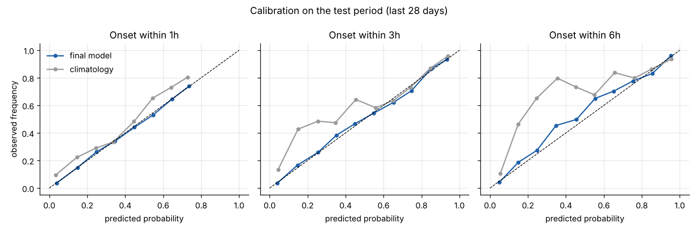
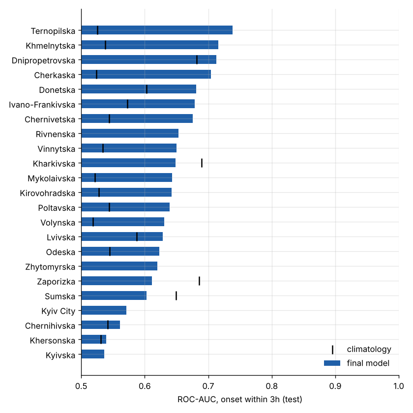

# alertcast — short-horizon forecasting of air-raid alerts in Ukraine

**Question answered:** *at the top of every hour, for every oblast, what is the probability that a new
air-raid alert starts within the next 1, 3 and 6 hours?*

The model is a global LightGBM classifier over leakage-safe features built from the alert history
(own region, neighbouring oblasts, the whole country, seasonality), plus optional text features from
the public Telegram channel of the Ukrainian Air Force (`@kpszsu`). It is evaluated on the **latest 28 days**
of data (14 Sep – 12 Oct 2026), which were never used for training or model selection.

## Results (test = last 28 days, 14 Sep – 12 Oct 2026, 24 oblasts × 672 hourly origins)

| onset within | climatology AUC | logistic regression AUC | **LightGBM (alerts + Telegram)** AUC | Brier: climatology → final | final, weekly refit AUC |
|---|---|---|---|---|---|
| 1 h (24% positive) | 0.733 | 0.767 | **0.786** | 0.160 → 0.147 | 0.790 |
| 3 h (50% positive) | 0.775 | 0.805 | **0.820** | 0.207 → 0.172 | 0.823 |
| 6 h (68% positive) | 0.834 | 0.859 | **0.866** | 0.173 → 0.130 | 0.867 |

* **Telegram helps, measured fairly.** Same rows, same window (May–Sep 2026), only the feature set differs:
  validation log-loss 0.427 → 0.415 (1 h), 0.495 → 0.477 (3 h), 0.412 → 0.393 (6 h); test ROC-AUC +0.005…+0.010
  on every horizon. Selection of "Telegram on" was made on validation, before looking at the test.
* **Well calibrated** on the test month (`reports/figures/calibration.png`) — the probabilities can be read literally.
* **The model ages**: static-model AUC (1 h) falls from 0.803 in the first test week to 0.760 in the last;
  refitting weekly (walk-forward, no leakage) recovers part of it (0.771). In deployment the model should be
  refit at least weekly.
* **Regime shift is real**: in Sep–Oct 2026 central/western oblasts were alerted far more often than the
  history suggests (Kyivska: 85% of 3-hour windows had an onset vs 46% climatology). The model tracks this via
  the 7-day activity features; climatology does not.
* Negative results kept on record: sub-hour (15/30 min) wave features gave no gain (AUC 0.7797 → 0.7798);
  training-window length barely matters (val log-loss 0.4241–0.4275 for windows from Jun 2024 to May 2026).

Full tables: [`reports/RESULTS.md`](reports/RESULTS.md). Figures: `reports/figures/`.




## Limitations

* The alert dataset is refreshed about once a day, so `predict.py` forecasts from the last hour covered by the
  dump, not from "now". A real-time deployment would replace the loader with a live alert API
  (e.g. alerts.in.ua, needs a token); the feature code does not change.
* Onset of an oblast-level alert only; raion/hromada granularity is not modelled.
* Oblast mentions in Telegram are matched with hand-written regexes (oblast names, declensions, major towns);
  ~8% of posts mention no recognisable place.
* AUC on a single 28-day test window: the weekly breakdown in `RESULTS.md` shows the spread (0.76–0.80 for 1 h).


## Quick start

```bash
pip install -r requirements.txt
python scripts/scrape_telegram.py --since 2026-05-01   # optional, ~20 min; a snapshot is committed
python scripts/run_experiment.py --download            # features, selection, test evaluation (~5 min)
python scripts/make_report.py                          # figures + reports/RESULTS.md
python scripts/predict.py --download --scrape          # live forecast for all oblasts
python -m pytest tests                                 # leakage tests
```

## Data

| source | what | period used |
|---|---|---|
| [Vadimkin/ukrainian-air-raid-sirens-dataset](https://github.com/Vadimkin/ukrainian-air-raid-sirens-dataset) `volunteer_data_en.csv` | oblast-level alert start/end, updated daily | Jun 2024 – 12 Oct 2026 |
| `t.me/s/kpszsu` (public web preview, no login) | Air Force posts: threat type and direction ("БпЛА на Харківщину", "балістика") | May – Oct 2026 |

Why the volunteer file and not the `official_data_en.csv` in the same repository: the official file
stopped updating on **2026-09-07** (the task asks for the most recent data), and in 2026 it records alerts
almost exclusively at raion/hromada level, so it is a different target. Luhanska oblast (3 records in 4.5 years)
is excluded; zero-length records are dropped. Remaining: 24 oblasts incl. Kyiv City.

## Problem formulation

* **Forecast origin** `t`: every full hour (UTC), every oblast.
* **Target** `y_h(t) = 1` if an alert *starts* in that oblast in `[t, t+h)`, `h ∈ {1, 3, 6}`.
  Onset (not "alert is active") was chosen because "is it active" is trivially predicted by persistence
  while an alert is on, and the useful question for a person planning the next hours is whether a *new* alert will come.
* Positive rates on the test period: 24% (1 h), 50% (3 h), 68% (6 h).

## No data leakage — how it is guaranteed

1. **Features only look at `[.., t)`.** Alerts are rasterised to a minute grid; every feature at origin `t`
   is a function of minutes/hours strictly before `t`. An alert that is still running at `t` is used only as
   "active now, for N minutes" — its future end time is never used.
2. **Seasonal lag features** (`y_h` same hour yesterday / last 7 days) use target windows that end before `t`.
3. **Telegram:** a post is used only if its publication timestamp is `< t`.
4. **Automated test** (`tests/test_leakage.py`): features are recomputed on data where everything at/after a cut
   time is removed (alerts not yet started are dropped, running alerts are clipped at the cut, later posts are
   dropped); features for all origins `≤ cut` must be identical. Runs on synthetic and on the real data.
5. **Time-based splits with embargo:** train `< val_start − h`, validation = 28 days, test = last 28 days;
   a row is placed in a split only if its whole target window lies inside it.
6. **Model selection** (training window, Telegram on/off, number of boosting rounds) uses validation only;
   the test period is scored once by the chosen configuration. The **walk-forward** variant refits every
   7 days on data available before that week.

Residual risks (documented, not hidden): Telegram's web preview shows the *current* text of a post, so a post
edited after publication could carry later information (rare in this channel); the volunteer dataset is curated
retrospectively, so in real time an alert record may arrive with some delay.

## Features (≈60)

* own region: active now, minutes since last alert, age of the current alert, occupancy and number of starts in
  the last 15 min / 30 min / 1 / 3 / 6 / 24 / 168 h;
* neighbours (hand-written oblast adjacency) and the whole country: same aggregates;
* seasonality: local (Kyiv) hour, day of week, target in the same window yesterday / share of the last 7 days;
* Telegram (optional): posts mentioning the oblast or its neighbours in the last 1/3 h, nationwide counts of
  drone / ballistic / missile / KAB / strategic-aviation posts.

## Repository layout

```
src/alertcast/data.py       download + cleaning, truncate_at() for leakage tests
src/alertcast/features.py   minute/hour grid, all features and targets
src/alertcast/geo.py        oblast adjacency, Ukrainian name regexes for Telegram matching
src/alertcast/telegram.py   t.me/s scraper
src/alertcast/model.py      LightGBM, logistic regression, climatology, seasonal naive, metrics
scripts/                    run_experiment.py, make_report.py, predict.py, scrape_telegram.py
tests/test_leakage.py       leakage tests
reports/                    RESULTS.md, CSV metrics, figures/
AI_LOG.md, REFLECTION.md    process documentation for the submission
```
